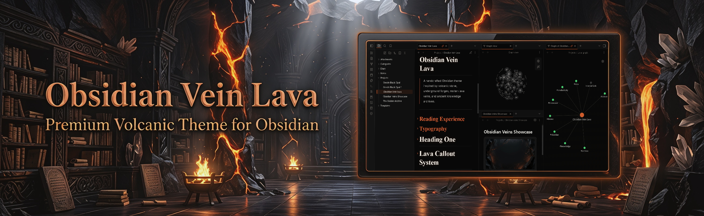
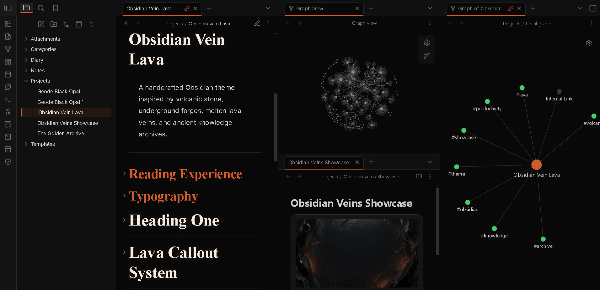
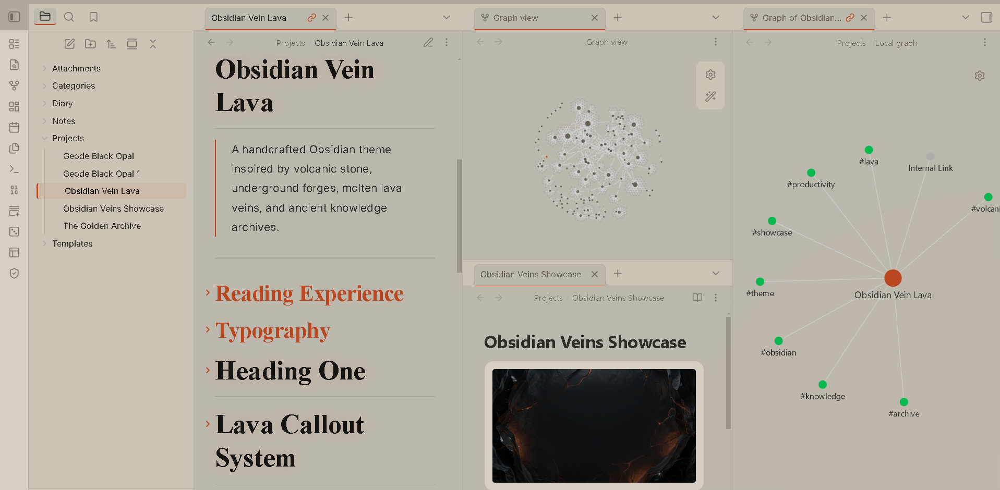
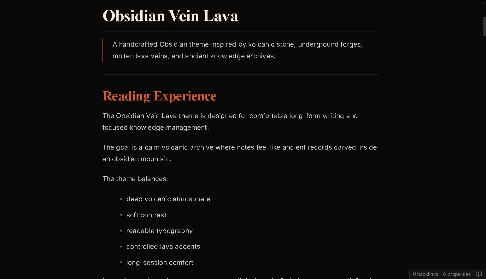
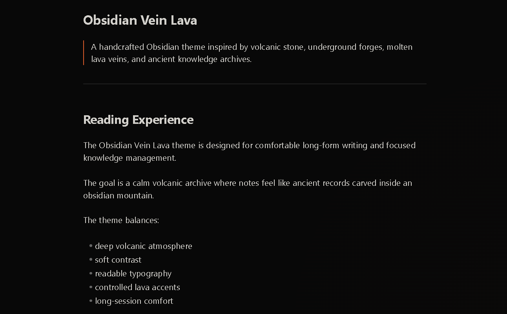
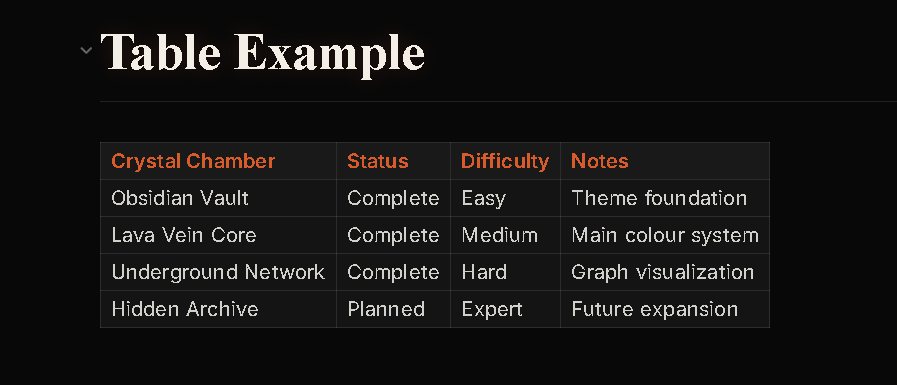
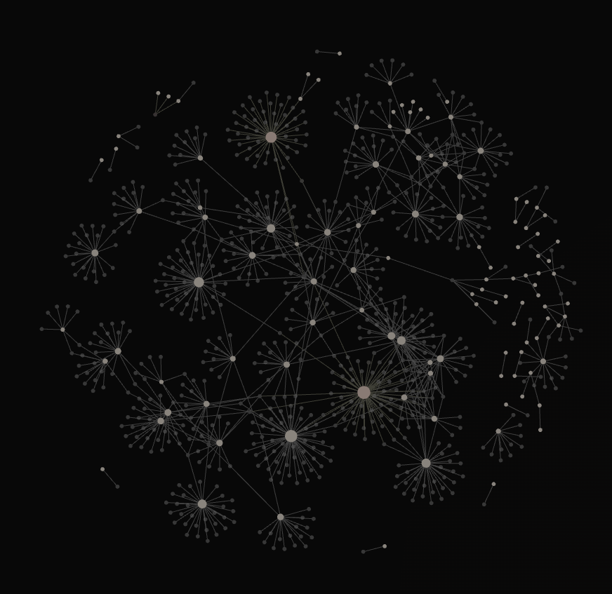
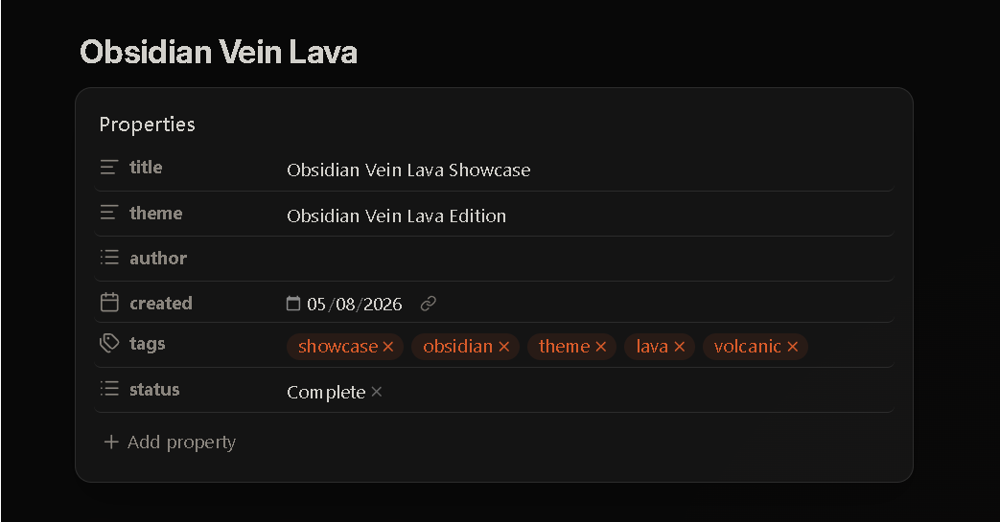
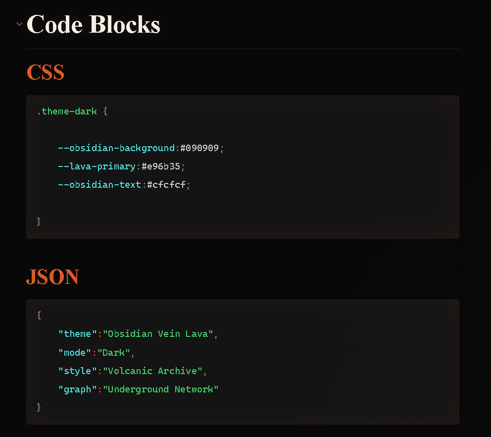
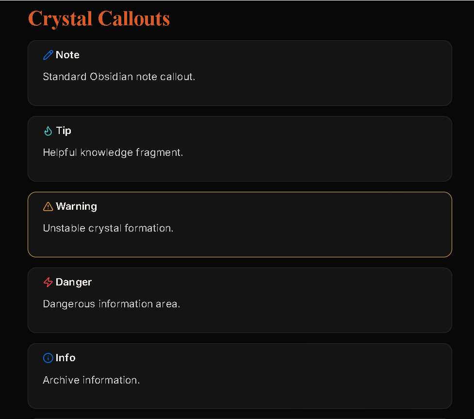

# Volcanic Vein Lava Lava


A handcrafted Obsidian theme inspired by **volcanic stone, ancient archives, underground chambers, and glowing lava veins**.

Designed for:

- Comfortable long-form reading
- Focused writing sessions
- Research workflows
- Knowledge management
- Low-glare daily use
- Premium volcanic atmosphere

---

# Preview



**An ancient knowledge archive carved inside a volcanic mountain.**

---

# Support ☕

If you enjoy this theme and want to support future development:

Your support helps with:

- New theme editions
- Plugin compatibility
- Long-term maintenance
- Community improvements

## Buy Me A Coffee

<a href="https://www.buymeacoffee.com/CosmicSeaFox" target="_blank">

</a>


## Ko-fi

<a href="https://ko-fi.com/cosmicseafox" target="_blank">

</a>

---

# Screenshots

## Dark Mode



Deep volcanic stone surfaces with molten lava veins and an underground forge atmosphere.

---

## Light Mode



Polished mineral surfaces exposed to daylight with warm volcanic reflections.

---

## Reading Experience



Balanced typography, spacing, and contrast designed for comfortable long writing sessions.

---

## Source Mode



A clean writing environment with reduced visual distractions.

---

## Tables



Archive-style tables using unified volcanic surfaces without distracting zebra row colors.

---

## Graph View



A knowledge network inspired by underground mineral formations and volcanic connections.

---

## Properties Panel



Metadata displayed as carved mineral information panels.

---

## Code Blocks



A soft volcanic terminal style designed for comfortable coding.

---

## Callouts



Custom knowledge chambers inspired by lava-filled volcanic structures.

---

# Features

| Feature | Description |
|---|---|
| 🌑 Dark Mode | Deep volcanic stone atmosphere |
| ☀️ Light Mode | Polished mineral daylight interface |
| 📖 Reading Mode | Comfortable long-form reading |
| ✍️ Source Mode | Focused writing environment |
| 🌋 Lava System | Controlled molten accent palette |
| 📝 Callouts | Custom volcanic knowledge chambers |
| 📊 Tables | Unified stone archive surfaces |
| 💻 Code Blocks | Low-glare coding panels |
| 🗂 Properties | Mineral metadata panels |
| 🕸 Graph View | Underground knowledge network |
| 🏷 Tags | Lava vein labels |
| ☑ Tasks | Custom magma checkboxes |
| 📅 Calendar | Volcanic timeline styling |
| 📱 Mobile | Responsive support |

---

# Installation

1. Download this repository.

2. Copy the theme folder into:

```
YourVault/.obsidian/themes/
```

3. Open Obsidian:

```
Settings → Appearance → Themes
```

4. Select:

```
Volcanic Vein Lava Lava
```

---

# Typography

| Purpose | Font |
|---|---|
| Body | Inter |
| Headings | Cormorant Garamond |
| Code | JetBrains Mono |

---

# Compatibility

| Feature | Status |
|---|---|
| Obsidian Desktop | ✅ |
| Obsidian Mobile | ✅ |
| Reading Mode | ✅ |
| Source Mode | ✅ |
| Live Preview | ✅ |
| Graph View | ✅ |
| Properties | ✅ |
| Tables | ✅ |
| Callouts | ✅ |
| Code Blocks | ✅ |
| Dataview | ✅ |
| Tasks | ✅ |
| Calendar | ✅ |
| Kanban | ✅ |
| Canvas | ✅ |
| Excalidraw | ✅ |

---

# Design Philosophy

Volcanic Vein Lava Lava focuses on:

- Reduced eye strain
- Calm visual hierarchy
- Premium material design
- Balanced contrast
- Minimal distraction
- Long writing comfort

Created for:

- Writers
- Researchers
- Students
- Developers
- Knowledge keepers

---

# Dark Mode

Features:

- Black volcanic stone
- Deep underground atmosphere
- Molten lava highlights
- Soft ambient glow
- Premium archive feeling

---

# Light Mode

Features:

- Polished volcanic surfaces
- Warm mineral colors
- Dark readable text
- Soft crystal reflections
- Comfortable daytime reading

---

# Theme Concept

## Ancient knowledge archive inside a volcanic mountain

### Dark Mode

- Black volcanic stone
- Glowing magma veins
- Deep underground chambers
- Warm forge atmosphere

### Light Mode

- Polished mineral stone
- Natural daylight
```